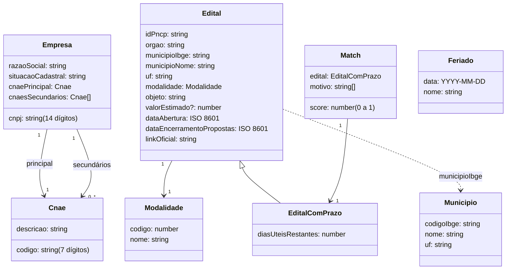

# Modelo de dados

Não há banco de dados. As entidades abaixo são tipos do domínio (`src/domain`), montados pelos adaptadores a partir das respostas do PNCP, da BrasilAPI e do IBGE, e guardados só no cache em memória.

## Notas

- `idPncp` é o número de controle do PNCP: `{cnpjOrgao}-1-{sequencial}/{ano}`. O `linkOficial` é derivado dele: `https://pncp.gov.br/app/editais/{cnpjOrgao}/{ano}/{sequencial}`.
- Datas do PNCP chegam sem fuso e são normalizadas para `-03:00` no adaptador (`normalizePncpDate`).
- `Empresa` não tem sócios: o quadro societário é descartado na fronteira (LGPD).
- `Match.motivo` lista cada termo encontrado com a origem, por exemplo `marmit (CNAE principal 5620104)`.
- Score: soma dos pesos dos termos únicos encontrados (principal 1, secundário 0,5) dividida por 2, limitada a 1.
